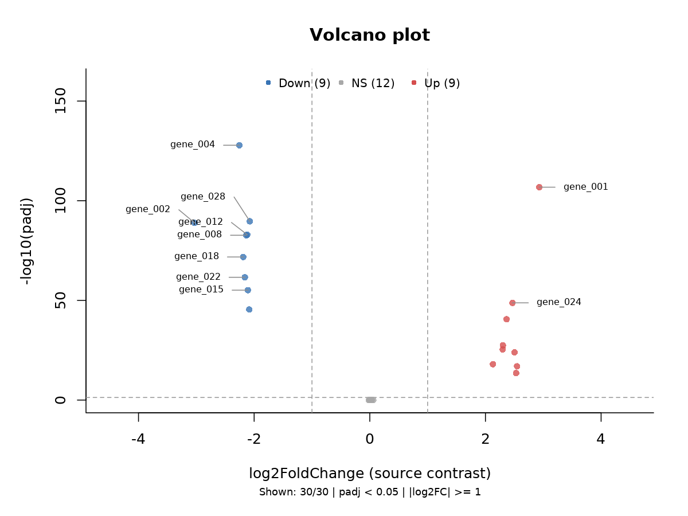

# LLM-driven Bulk RNA-seq Analysis Platform

Local release candidate **0.8.0rc1** · [Release notes draft](RELEASE_NOTES.md). Remote CI and publication await approval.

[中文使用指南](docs/user-guide.zh.md) · [Reproduce the demo](examples/demo/README.md) · [Architecture](docs/architecture.md) · [Developer guide](docs/developer-guide.md)

Start with a raw gene-count matrix and sample groups. Compare two conditions with DESeq2, explore samples with PCA, and follow a differential-expression result through plots and enrichment. Each project keeps the inputs, runs, artifacts and parent relationships together.

DeepSeek translates analysis requests into tool arguments or a workflow plan. The local backend validates the plan, resolves dependencies and calls registered Python/R Skills. Scientific results come from those programs. A user can also submit explicit parameters or a plan directly through FastAPI and work offline.

## Analyses

| Skill | What it consumes | What you can inspect |
|---|---|---|
| DEG | Raw non-negative integer counts, sample metadata, treatment and control | Full and filtered DESeq2 tables, direction and thresholds |
| PCA | Raw counts and sample groups | VST-based coordinates, explained variance and plot |
| Volcano | A completed DEG table | Classification, plot data and image |
| Heatmap | DEG, metadata and normalized expression or counts for VST | Selected genes, expression matrix and image |
| GO and KEGG | Target genes, a measured background and local gene-to-term mappings | Enriched terms, effective universe, tables and figures from clusterProfiler |

The workflow starts after counting. Read alignment and FASTQ quantification are outside its scope. Bring your own annotation for non-model organisms, or import eggNOG-mapper annotations through the workspace.

## Quick start on Windows

Start Docker Desktop with the Linux engine (WSL 2 backend). From the repository root in PowerShell, run:

```powershell
docker compose config -q
docker compose up -d --build --wait
docker compose ps
```

Open [the workspace](http://127.0.0.1:8501/) or [the interactive API](http://127.0.0.1:8000/docs). The first build includes R and Bioconductor. In the sidebar create a project, then open **Files** and import [counts.csv](examples/data/counts.csv) and [metadata.csv](examples/data/metadata.csv). The demo groups are named `treatment` and `control`.

For natural-language requests, copy [.env.example](.env.example) to a local `.env` if you do not already have one. Set your own `DEEPSEEK_API_KEY` before starting the services. After changing it, recreate the containers when analyses are idle. Running explicit Skills and browsing results require no model key. Stop with `docker compose down`; keep the named volume to reopen projects. See the [deployment and backup guide](container/README.md) for port overrides, disk requirements and troubleshooting.

## Follow one result

For example, ask for differential expression with treatment relative to control, a volcano plot and KEGG enrichment of the upregulated genes. The plot and enrichment both depend on the DEG. PCA can run independently. The [five-part offline demonstration](examples/demo/README.md) exercises these same backend capabilities on synthetic data and produces inspectable outputs.



In **Results**, select a workflow or run to preview tables and download artifacts. The project records parent run IDs. When counts or metadata change, the resolver checks the input fingerprint before reusing an earlier DEG. An explicitly chosen historical result keeps its historical scope. Controlled customization saves a separate result with its source. See [reproducibility and evidence boundaries](docs/reproducibility.md).

## How the application fits together

Streamlit and FastAPI are independent clients of the same installed backend and persistent workspace. The Registry connects validated requests to six Skills. The workflow executor runs a validated DAG in order and records step outcomes. See the [five editable architecture diagrams](docs/architecture.md).

## Tests and release status

Run the same local gate as CI with `py -3.13 scripts/ci/run.py fast` using Python 3.13.2 on Windows. The independent `scientific` and `docker` gates exercise real R and container services. The [CI guide](scripts/ci/README.md) documents prerequisites and baseline tolerances. See the [local hardening report](PHASE10_SECURITY_RELEASE_HARDENING_REPORT.md) for dated results. Remote GitHub Actions verification and the formal release remain pending.

The supported deployment is a trusted user on localhost. The platform has no public multi-user authorization system. Model requests can select registered operations and validated parameters. The separate isolated-worker prototype accepts only fixed trusted tasks. Future work includes fuller per-run provenance and remote CI verification.

## Documentation

- [中文教程：自己的数据、分组、分析与下载](docs/user-guide.zh.md)
- [Public demo and presentation walkthrough](examples/demo/README.md)
- [Developer guide and source navigation](docs/developer-guide.md)
- [Container deployment, persistence and backup](container/README.md)
- [Dependency locks](container/locks/README.md) and [security review](PHASE10_SECURITY_RELEASE_HARDENING_REPORT.md)
- [Phase 10.5 documentation and demo evidence](PHASE10_DOCUMENTATION_DEMO_REPORT.md)

## License and citation

The platform is distributed under the [MIT License](LICENSE). For a methods section, record the exact platform revision and environment used and cite the scientific software that performed the analysis, including DESeq2 or clusterProfiler as applicable.
