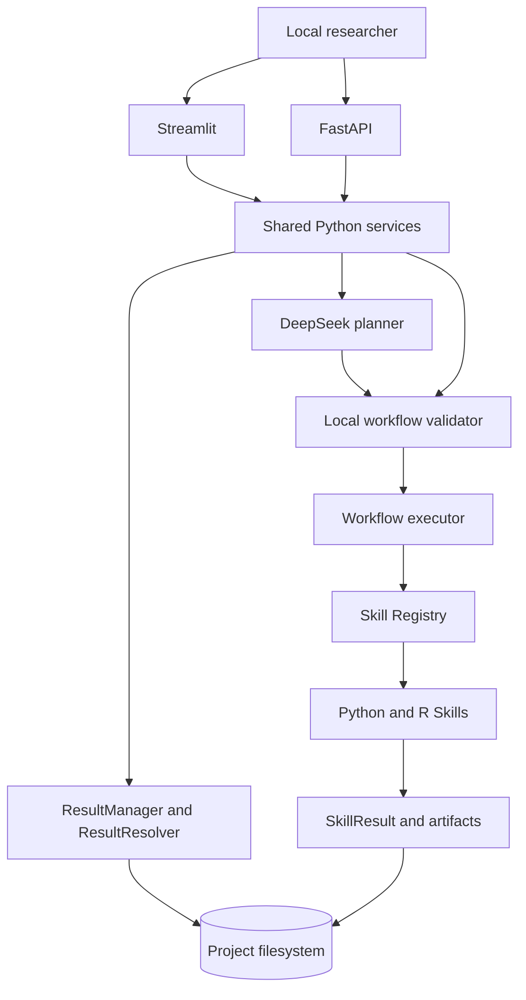
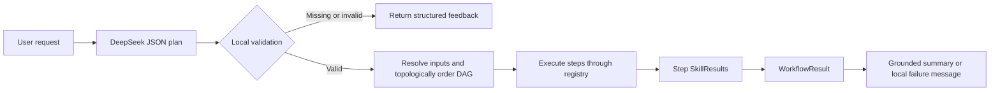
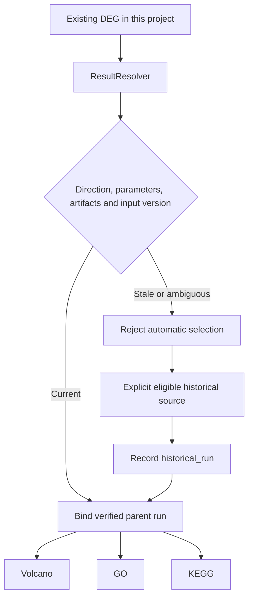
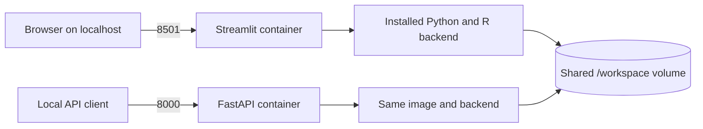
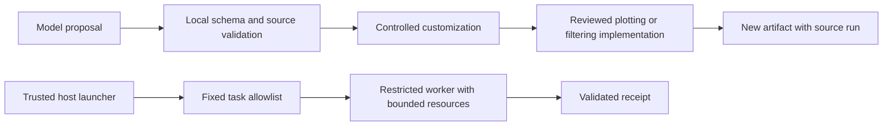

# Architecture

## Two entry points

Explicit Skill requests use the registry without contacting a provider. Chat additionally has a single-tool route. A manifest describes inputs and capabilities; local code holds the executable binding.

## A multi-step request

Volcano and enrichment can be siblings of one DEG step. An upstream failure skips dependent steps. Independent branches can still complete.

## Which DEG can a new plot use?

Historical selection still requires the needed source artifacts. Children carry the parent run ID; the old comparison keeps its original direction. For the explicit/automatic distinction see the [reuse guide](reproducibility.md).

## Deployment

Both services access the volume directly. A short file lock protects shared metadata updates. R analysis runs outside that lock.

## Execution boundary

The isolated-worker prototype has its own host launcher. Chat, FastAPI and Streamlit have no general shell or Docker execution endpoint. The worker receipt is infrastructure evidence. [Worker contract and limits](../container/isolated/README.md)
