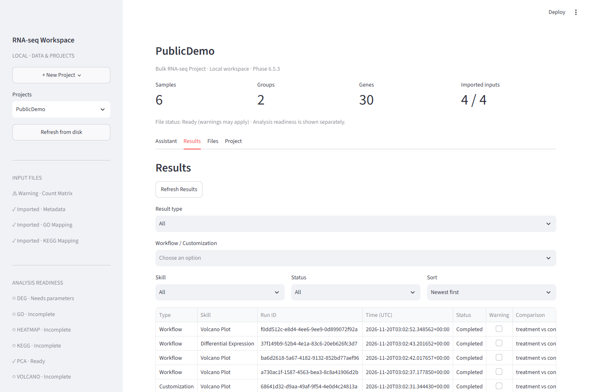

# A reproducible tour with synthetic counts

Allow one Linux/amd64 Docker Engine, Docker Compose and a host Python 3 interpreter. The first image build can take substantial time. From PowerShell at the repository root run:

```powershell
py -3.13 examples/demo/run.py --keep-running
```

The runner prints a loopback port for Streamlit. Open it, select **PublicDemo** under **Projects**, and go to **Results**. It also prints the exact command to stop this stack. Omit `--keep-running` to stop the two services after collecting evidence. Each invocation creates a unique Compose project and a new persistent volume. Keep track of those volume names; starting a new demo consumes additional disk. The runner passes an empty env file and an empty provider key, uses dynamically assigned ports, and leaves existing projects untouched.

## Inputs and expected observations

The four small tables are [raw counts](../data/counts.csv), [six sample assignments](../data/metadata.csv), [GO mapping](../../tests/fixtures/ci_science/go.tsv) and [KEGG mapping](../../tests/fixtures/ci_science/kegg.tsv). The annotations deliberately use synthetic term descriptions. File hashes are recorded under `input_sha256` in the [scientific reference](../../tests/fixtures/ci_science/reference.json).

| Demo | What the program actually runs | Evidence to inspect |
|---|---|---|
| A · Counts to plots | Import files, run PCA independently, then execute a locally supplied plan with DEG feeding Volcano and Heatmap. | 30 genes, 3 samples per group. Treatment vs control has 9 up and 9 down. PC1/PC2 explain 98.40%/1.12%. Top 50 requests use the 18 eligible heatmap genes. |
| B · Functional tests | Bind the first DEG to clusterProfiler GO and KEGG for all, up and down subsets. | Effective mapped background 30; mapped targets 18, 9 and 9. Significant terms per subset are 0, 0 and 1 for both skills. These numbers describe the fixture only. |
| C · Reuse | Resolve the existing DEG and draw another Volcano; compare the indexed runs and source checksum. | One additional plot, one DEG total before the input change, identical source table hash and the original parent ID. |
| D · Input version | Change one integer by 1 in a temporary copy named counts.csv. Import it as a replacement, request an automatic Volcano, explicitly select the old source, then run a new DEG and another automatic Volcano. | HTTP 409 `STALE_DEG_RESULT`; explicit child has `historical_run`; new child has `current_input_snapshot` and the new parent ID. |
| E · Controlled customization | During the initial workflow tour, apply a reviewed Volcano parameter override: five gene labels and a new title. | The customization collection records a new figure and its source DEG. The original DEG checksum remains intact. |

The runner uses the existing [container smoke](../../container/smoke_runtime.py) for A/B/C/E and [the version demonstration](version_guard.py) for D. The plan and customization parameters are supplied locally. No model chose these steps in this demonstration.

## Show the evidence

1. **Start with the inputs.** Open **Files**. Show the sample names, the two groups and the two annotation roles. The one-count replacement in D is already the project's active version.
2. **Follow a result.** Open **Results**, choose **Workflow**, and select the original multi-step workflow. Identify the DEG parent and its two plot children. Expand a run to preview the figure or download the table.
3. **Explain a zero.** Select an all-genes GO or KEGG run. Its success status and empty significant table show that the enrichment test completed at the chosen threshold.
4. **Compare versions.** Show the two DEG run IDs in the [observed summary](observed.json). Trace the explicit historical Volcano and the new automatic Volcano to their respective parents. Open **Customization** to show the replot from the original source.



The screenshot comes from the isolated Linux-container workspace after D. The sidebar lists current input/parameter readiness; the table shows completed history. Each run writes a new `outputs/public-demo/<stack>/summary.json` and `volcano.png`. The [published figure](../../docs/demo-volcano.png) comes from the first workflow, before input replacement. Run IDs change on replay.
